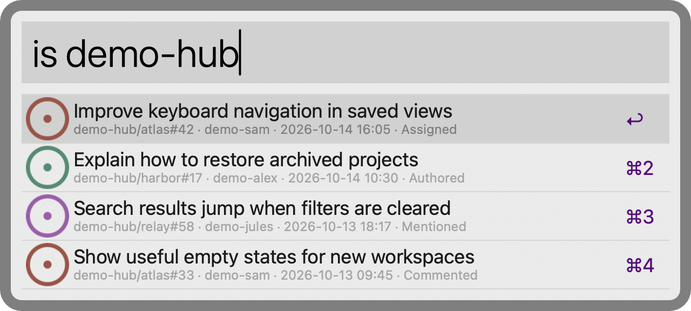

# Hubfred

Find and open the GitHub pull requests and issues that involve you, right from Alfred.

## Install

[Download Hubfred.alfredworkflow](../../releases/latest/download/Hubfred.alfredworkflow) and open it in Alfred. Requires Alfred 6 with Powerpack and [GitHub CLI](https://cli.github.com/) signed in to github.com.

## Pull Requests

> Type `pr` followed by a space to find open pull requests you authored or were asked to review.

> Type `prs` and press Enter to filter by involvement and preview the selected PR.

## Issues

> Type `is` followed by a space to find open issues you were assigned to, authored, were mentioned in, or commented on.

> Type `iss` and press Enter to filter by involvement or label and preview the selected issue.

Search by title, repository, or number. Press Enter to open the selected item on GitHub.

See [MAINTAINER.md](MAINTAINER.md) for development, screenshots, and releases.
