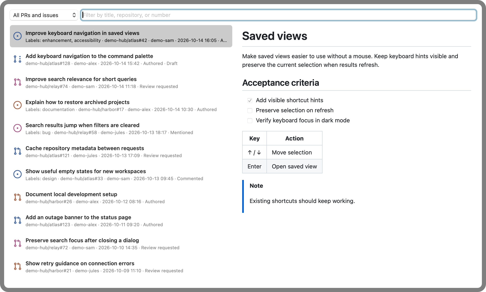

# hubfred

Find and open the GitHub pull requests and issues that involve you, right from Alfred.

## Install

[Download the latest release](../../releases/latest) and open the `.alfredworkflow` file in Alfred. Requires macOS 15 or later, Alfred 6 with Powerpack, and [GitHub CLI](https://cli.github.com/) signed in to github.com.

## Pull Requests

> Type `pr` followed by a space to find open pull requests you authored or were asked to review.

> Type `prs` and press Enter to filter by involvement and preview the selected PR.

## Issues

> Type `is` followed by a space to find open issues you were assigned to, authored, were mentioned in, or commented on.

> Type `iss` and press Enter to filter by involvement or label and preview the selected issue.

## Pull Requests and Issues

> Type `gh` followed by a space to find both pull requests and issues in one picker.
>
> 

> Type `ghs` and press Enter to open the combined dashboard. Filter by item type, involvement, or label and preview either kind of item.
>
> 

Pickers show up to 10 items, most recently updated first. With a query, they filter the broader dashboard results before taking the latest 10 matches. If the dashboard cache is missing or stale, the workflow refreshes it from GitHub. Dashboards show all items returned by their searches.

Search by title, repository, or number. In a picker, a repository name can also be matched by its prefix without the owner (for example, `gh widget` matches `example-org/widget-builder`). Press Enter to open the selected item on GitHub.

See [MAINTAINER.md](MAINTAINER.md) for development, screenshots, and releases.
