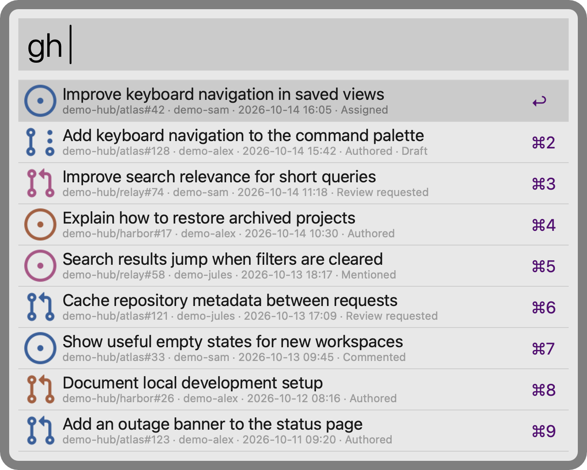
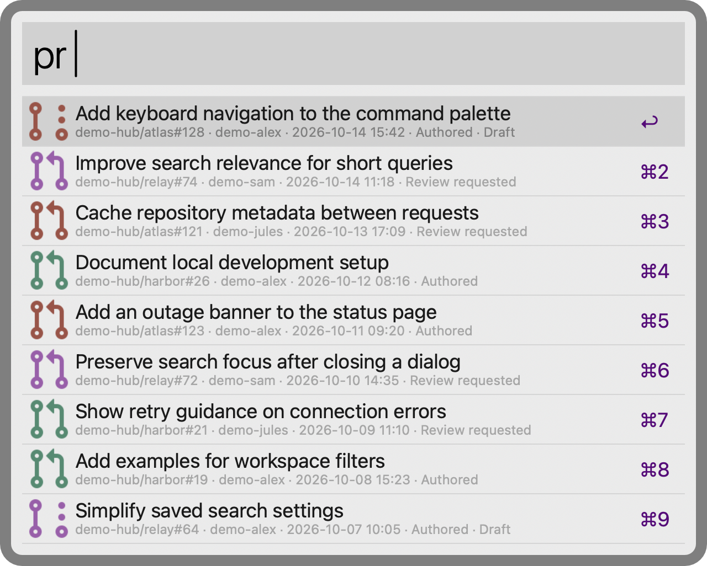
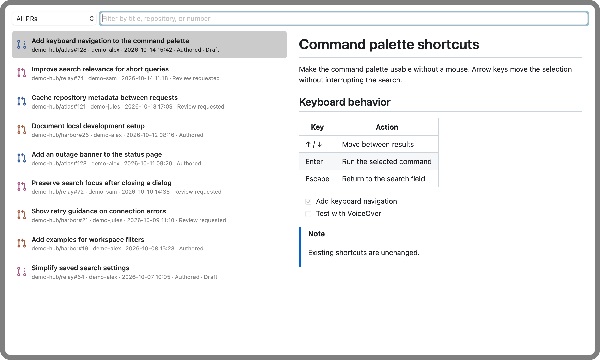
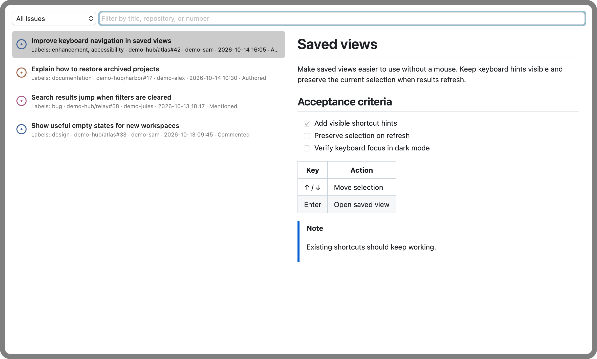

# hubfred

Find and open the GitHub pull requests and issues that involve you, right from Alfred.

## Setup

Requires macOS 15 or later and Alfred 6 with Powerpack.

In Terminal, sign in to GitHub.com:

```sh
gh auth login --hostname github.com
```

To avoid conflicts with other workflows, change the picker and dashboard keywords in Alfred’s **Configure Workflow** window. The examples below use the defaults.

## Usage

Search the open pull requests and issues that involve you via the `gh` keyword.



Browse both kinds of items, filter by type, involvement, or label, and preview descriptions via the `ghs` keyword.


### Pull Requests

Find open pull requests you authored or were asked to review via the `pr` keyword.



Filter open pull requests by involvement and preview the selected description via the `prs` keyword.



### Issues

Find open issues you were assigned to, authored, were mentioned in, or commented on via the `is` keyword.


Filter open issues by involvement or label and preview the selected description via the `iss` keyword.



For a picker (`gh`, `pr`, or `is`), type a space after the keyword. Pickers show up to 10 results, newest updates first. A query filters a broader GitHub snapshot before taking the latest 10 matches. Dashboard limits do not narrow picker searches.

For a dashboard (`ghs`, `prs`, or `iss`), press <kbd>↩</kbd> after typing the keyword. In **Configure Workflow**, choose **Dashboard results per search** (10, 25, 50, 100, 200, 500, or 1,000 per category before deduplication; default 100) and **Dashboard update period** (no limit, or the last 7, 30, 90, or 365 days; default no limit). Dashboards can show recent picker results while fetching their first pages, then add any remaining results.

Search by title, repository, or number. In pickers, you can omit the owner and enter the start of a repository name. Press <kbd>↩</kbd> on a result to open it on GitHub.

## Install from GitHub

Install [GitHub CLI](https://cli.github.com/), [download the latest release](https://github.com/kasutera/hubfred/releases/latest), and open the `.alfredworkflow` file in Alfred.

See [MAINTAINER.md](MAINTAINER.md) for development, screenshots, and releases.
